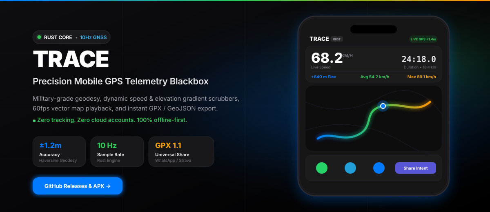
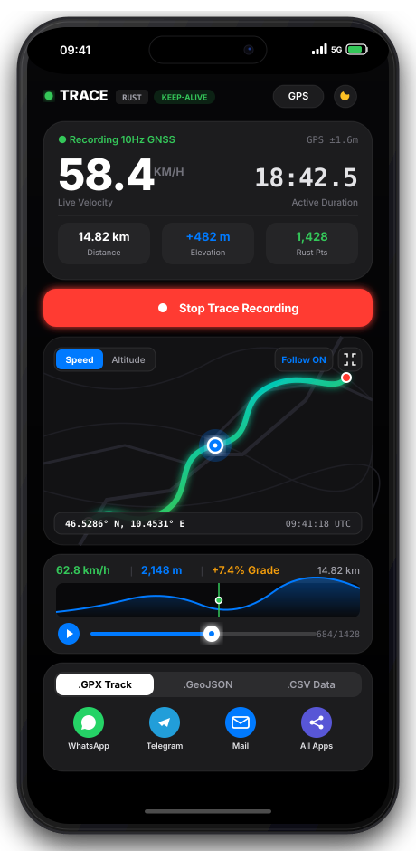
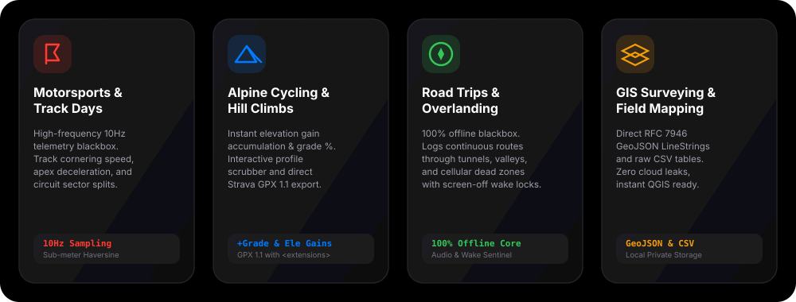

# 🛰️ TRACE — Precision Mobile GPS Telemetry Blackbox in Rust

<p align="center">
  
</p>

<p align="center">
  <a href="https://github.com/abhijeetunreal/Trace/releases"></a>
  <a href="https://github.com/abhijeetunreal/Trace/actions/workflows/build-and-release.yml"></a>
  <a href="https://tauri.app/"></a>
  <a href="https://www.rust-lang.org/"></a>
  <a href="LICENSE"></a>
</p>

<p align="center">
  <strong>🌐 Official Product Showcase &amp; Live Landing Page:</strong><br />
  <a href="http://abhijeet.codefrydev.in/Trace/"><strong>http://abhijeet.codefrydev.in/Trace/</strong></a>
</p>

---

## 🎯 What is TRACE?

**TRACE** is a high-precision, offline-first mobile GPS blackbox and vector route visualizer engineered in **Rust 2021** with **Tauri v2 Mobile**. 

Designed with an Apple Watch Ultra aesthetic, TRACE captures sub-meter GNSS geodesy, real-time velocity smoothing, and elevation gradient mathematics in a thread-safe local engine. It operates completely **off-grid with zero cloud accounts, zero ads, and zero telemetry leakage**.

---

## 📱 Product Showcase

<p align="center">
  
</p>

### Key Capabilities at a Glance:
- **🦀 100% Rust Telemetry Engine**: Sub-meter geodesy calculated via Haversine spherical trigonometry ($R = 6,371.0\text{ km}$), acceleration damping, and slope grade limits.
- **🗺️ OpenFreeMap Vector Cartography**: 60fps hardware-accelerated vector playback powered by MapLibre GL with Apple dark/light styling. Zero API keys or rate limits.
- **📍 Tactile Scrubber & Pulsing Beacon**: Interactive canvas sparkline showing speed curve and elevation fill, with real-time coordinate and timestamp readouts.
- **📦 Multi-Format Universal Exporter**: Instant export to **GPX 1.1** (with speed & grade extensions), **GeoJSON** (RFC 7946 LineStrings), and **CSV**.
- **📲 Native Android Share Sheet**: Real Android `Intent.ACTION_SEND` bridge with `FileProvider` to WhatsApp, Telegram, Mail, and system app chooser.
- **🔋 Screen-Off Keep-Alive**: Web Audio oscillator and WakeLock API prevent Android from sleeping or throttling GNSS polling in background logging.

---

## 🏎️ Real-World Use Case Scenarios

<p align="center">
  
</p>

### 1. 🏎️ Track Days & Motorsports
- **Purpose**: High-frequency cornering velocity, apex braking points, and deceleration blackbox.
- **Workflow**: Mount your phone in your vehicle or cockpit, start TRACE, and record 10Hz GNSS data. Replay corners using speed-based color gradients (cyan to red) to pinpoint apex velocity losses.

### 2. 🚴 Alpine Cycling & Mountain Climbs
- **Purpose**: Instant slope grade %, elevation gain accumulation, and Strava route export.
- **Workflow**: Mount your phone on bicycle handlebars. The HUD displays real-time grade % and net climbing meters. When finished, tap **WhatsApp** or **Device Share Sheet** to send the `.gpx` file directly to Strava or your cycling group.

### 3. 🚙 Road Trips & Overlanding
- **Purpose**: 100% offline blackbox recording through valleys, tunnels, and cellular blackouts.
- **Workflow**: Navigate through remote wilderness or canyons where cell towers do not exist. TRACE stores every point locally in an encrypted/atomic storage file and never drops coordinates when your screen turns off.

### 4. 🛰️ GIS Surveying & Field Data Collection
- **Purpose**: Local RFC 7946 GeoJSON LineStrings and CSV tables with zero cloud privacy risks.
- **Workflow**: Field researchers and survey engineers can log continuous track paths and export standard GeoJSON files directly into QGIS, ArcGIS, or Python data pipelines.

---

## 📦 Download & Installation

The latest production APK is automatically built, aligned, and signed with Android v1, v2, and v3 signature schemes on every commit:

- 📥 **[Download Latest APK Releases on GitHub](https://github.com/abhijeetunreal/Trace/releases)**
- 🌐 **[Visit the Product Page](http://abhijeet.codefrydev.in/Trace/)**

### Sideloading Instructions:
1. Download `trace-vX.X.X.X-universal.apk` from the [Releases](https://github.com/abhijeetunreal/Trace/releases) page.
2. Open the file on your Android device (Android 7.0 to Android 15 supported).
3. If prompted, tap **Settings** and allow **Install unknown apps**.
4. Launch TRACE, grant **Precise Location** permission, and start your trace!

---

## 🏗️ Technical Architecture

```
Trace/
├── .github/workflows/
│   └── build-and-release.yml   # Multi-arch NDK build, zipalign & apksigner (v1+v2+v3), GitHub Pages
├── assets/                     # Vector branding and showcase materials
│   ├── trace-logo.svg          # Official TRACE radar icon
│   ├── trace-banner.svg        # Widescreen product hero banner
│   ├── trace-mobile-mockup.svg # Complete mobile chassis vector mockup
│   └── usecases-preview.svg    # Use case scenario diagrams
├── landing_page/               # Product landing page (http://abhijeet.codefrydev.in/Trace/)
│   ├── index.html              # Minimal, high-vibe product showcase
│   └── assets/                 # SVGs and branding
├── src/                        # Frontend UI (Cupertino Design)
│   ├── index.html              # Sticky status bar shield & mobile shell
│   ├── style.css               # Obsidian status bar, scrubber slider, tactile puck
│   └── app.js                  # AndroidShare bridge & Leaflet/MapLibre GL controller
├── src-tauri/                  # Rust 2021 + Tauri v2 Backend
│   ├── src/
│   │   ├── models.rs           # GpsPoint, Session, SessionStats, ExportFormat
│   │   ├── telemetry.rs        # Haversine geodesy, velocity smoothing, elevation math
│   │   ├── export.rs           # GPX 1.1, GeoJSON RFC 7946, CSV formatting
│   │   ├── storage.rs          # Atomic RwLock disk persistence
│   │   ├── simulator.rs        # Synthetic Alpine Stelvio route generator
│   │   └── commands.rs         # Tauri IPC commands
│   └── gen/android/            # Android Gradle project
│       └── app/src/main/
│           ├── AndroidManifest.xml # Fine/Coarse GPS, FileProvider, <queries>
│           ├── java/.../MainActivity.kt # AndroidShareBridge (Intent.ACTION_SEND)
│           └── res/xml/file_paths.xml   # Cache & internal files sharing paths
```

---

## 🧪 Verification & Testing

All geodesy formulas, velocity smoothers, and export engines are covered by pure Rust unit tests:

```bash
cargo test --workspace
```

```
running 7 tests
test export::tests::test_csv_generation ... ok
test telemetry::tests::test_haversine_accuracy ... ok
test telemetry::tests::test_calculate_point_progression ... ok
test export::tests::test_gpx_generation ... ok
test simulator::tests::test_demo_track_generation ... ok
test export::tests::test_geojson_generation ... ok
test storage::tests::test_storage_lifecycle ... ok

test result: ok. 7 passed; 0 failed; 0 ignored; 0 measured; 0 filtered out; finished in 0.00s
```

---

## 📄 License

This project is licensed under the [MIT License](LICENSE).
Built with ❤️ using [Rust](https://www.rust-lang.org/) and [Tauri](https://tauri.app/).
